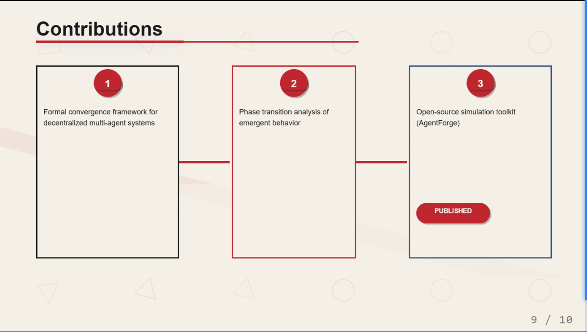
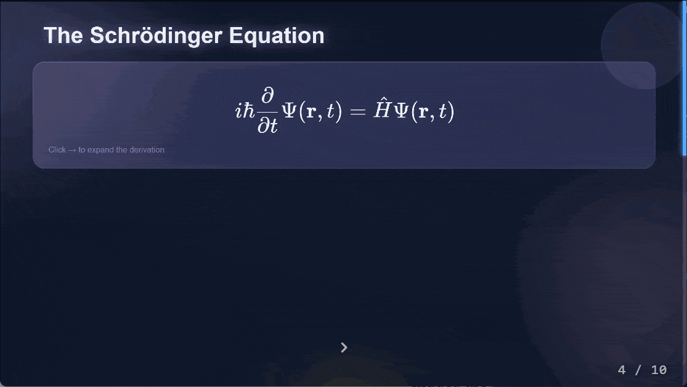
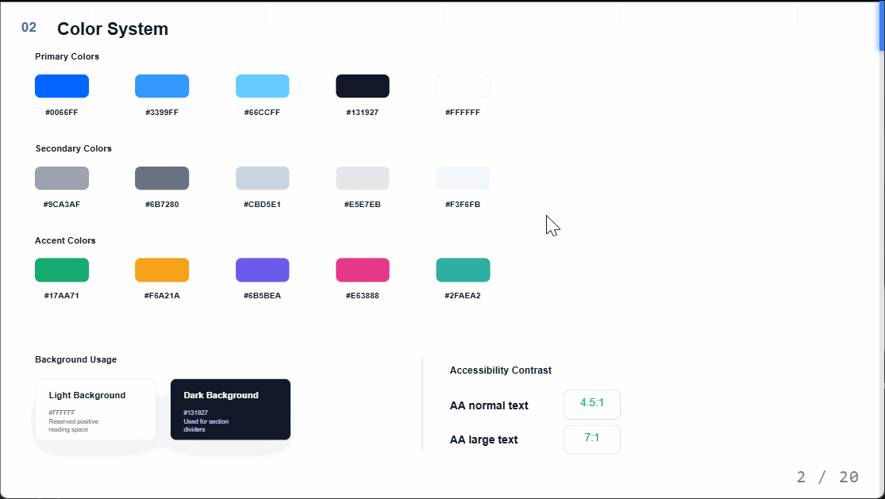
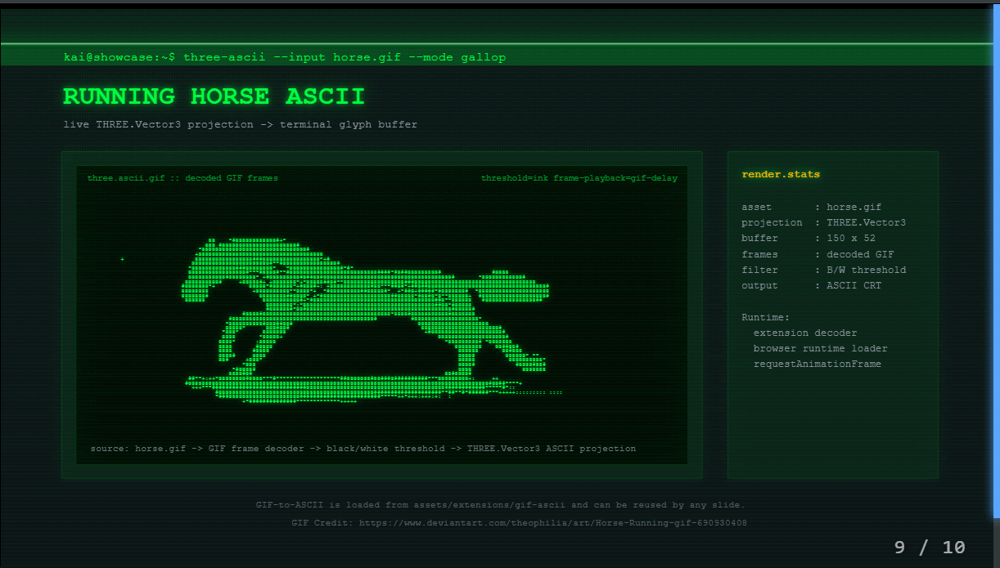
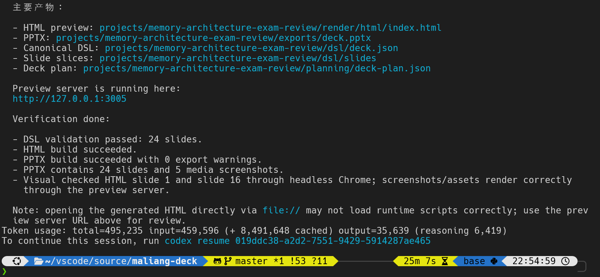
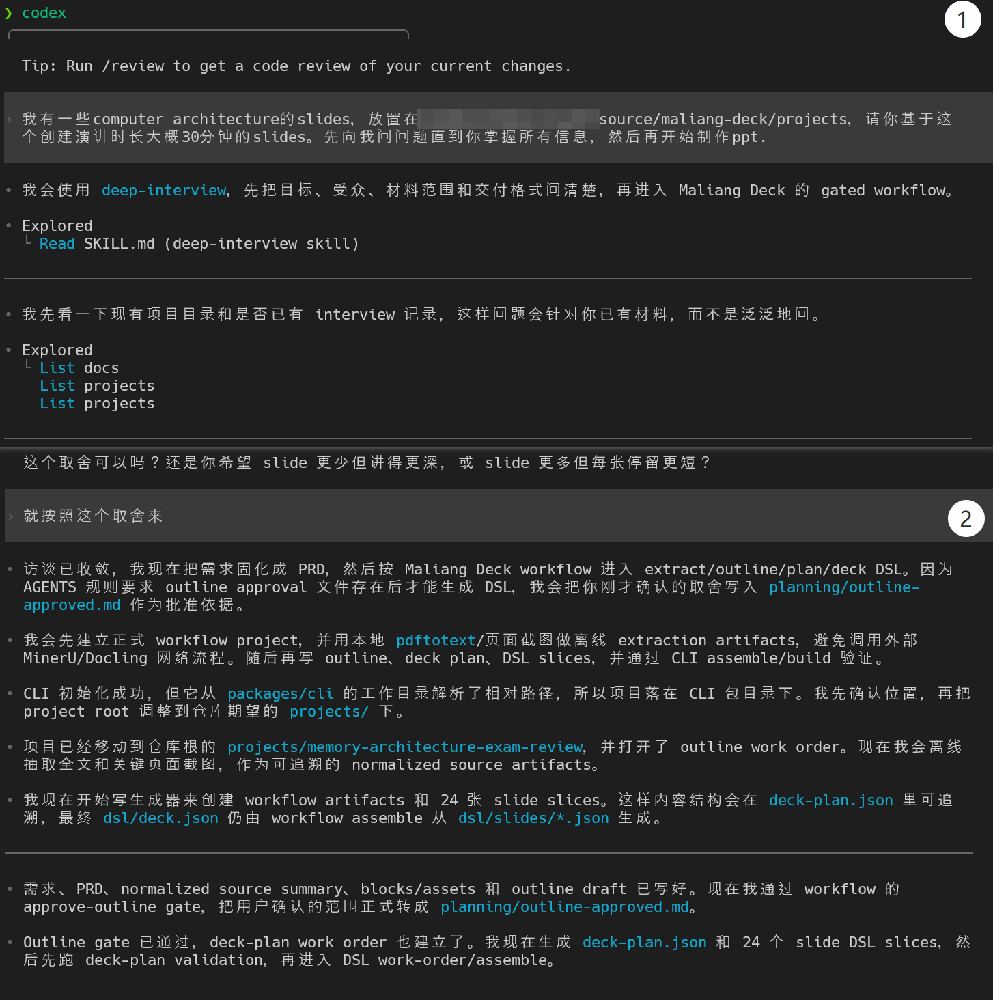

<p align="center">
  <strong>English</strong> ·
  <a href="./README_ZH.md"><strong>中文</strong></a> ·
  <a href="https://jeffeychou.github.io/maliang-deck/"><strong>Live Demo</strong></a>
</p>

# Maliang Deck -- Domain-Specific Language (DSL) For Slide Production

Maliang Deck is a DSL-first slide production workflow for creating polished business, technical, academic, and narrative decks from structured content. It keeps a validated JSON deck DSL as the source of truth, then renders that same deck into interactive HTML, PDF, and editable PPTX.

```text
JSON deck DSL -> HTML preview and runtime
JSON deck DSL -> SVG -> PDF export
JSON deck DSL -> SVG metadata -> DrawingML PPTX export
```

The goal is simple: focus on the message, structure, evidence, and design intent. Do not hand-edit generated HTML, SVG, PDF, or PPTX as the canonical deck. Change the DSL, validate it, assemble it, and rebuild the outputs. 

Think about it as a kind of "TeX", where we write structured content and markup in a durable source format, then compile it into presentation formats for review and delivery. Stop wasting tokens on brittle markup and fragile HTML generation. Start describing your deck in a structured way, then let the workflow handle the rest.

## Why Maliang Deck

Most agent-generated slide workflows make the agent spend tokens directly on
raw HTML, SVG, XML, or PPTX internals. That can work for small decks, but it is
fragile when the deck needs validation, multiple export targets, animations,
speaker tools, and later revision. Maliang Deck keeps a typed JSON deck DSL as
the source of truth, then compiles it into interactive HTML, PDF, and editable
PPTX.

| Capability | HTML-first slide tools | PPTX-oriented slide tools | Maliang Deck |
| --- | --- | --- | --- |
| Canonical source | Browser markup is often the working artifact. | PowerPoint structures or generated PPTX become the handoff artifact. | Validated JSON deck DSL remains the durable source of truth. |
| Agent workload | Agents spend many tokens on raw HTML/CSS/SVG details. | Agents often reason about low-level PPTX/XML constraints. | Agents describe slide structure, data, layout intent, animation metadata, and export options in typed DSL. |
| Workflow control | Fast for visual experiments, but review gates are usually informal. | Strong when PowerPoint is the only target, but less suited to web-first review. | Extraction, normalization, outline approval, deck planning, DSL generation, assembly, and export are separate gates. |
| Output targets | HTML is natural; PDF/PPTX can become screenshots or secondary conversions. | PPTX is natural; rich browser presentation is usually limited. | The same DSL renders to HTML preview/runtime, PDF, and editable DrawingML PPTX. |
| Validation before export | Mostly browser inspection and manual QA. | Often tied to whether the generated PPTX opens correctly. | Schema checks, bounds checks, missing-asset checks, consistency checks, and export diagnostics happen before delivery. |
| Animation and live delivery | Browser animation is strong, but static fallbacks may be ad hoc. | PowerPoint animation is possible, but runtime tools are limited. | Reveal steps, transitions, morphing, laser mode, presenter mode, whiteboard, and predictable static fallbacks are built into the workflow. |
| Revision model | Later edits can drift from the original generation prompt. | PowerPoint edits can disconnect from the source plan. | Revise the DSL and rebuild, so HTML, PDF, and PPTX stay aligned. |

## Gallery

<table>
  <tr>
    <td width="50%" align="center">
      
      <br>
      <strong>Runtime animation</strong>
    </td>
    <td width="50%" align="center">
      
      <br>
      <strong>KaTeX morphing and 3D plot support</strong>
    </td>
  </tr>
  <tr>
    <td width="50%" align="center">
      
      <br>
      <strong>Utility tool support</strong>
    </td>
    <td width="50%" align="center">
      
      <br>
      <strong>Runtime visual effects with Three.js</strong>
    </td>
  </tr>
  <tr>
    <td width="50%" align="center">
      
      <br>
      <strong>Image-aware PPTX export</strong>
    </td>
    <td width="50%" align="center">
      
      <br>
      <strong>495k token usage after a 7-round interview to create 24-slide HTML and PPTX outputs</strong>
    </td>
  </tr>
</table>

## Features

- **DSL first**: JSON deck DSL is the durable source of truth.
- **Content focused**: gated workflow supports source extraction, normalized materials, outline approval, deck planning, slide DSL, assembly, and build.
- **No canonical HTML edits**: generated HTML is preview/export output, not the file you maintain by hand.
- **Rich customization**: typed elements, layouts, charts, tables, formulas, themes, CSS themes, custom FX, runtime extensions, Three.js/WebGL modules, and controlled `customHtml` escape hatches with export fallbacks.
- **Multiple exports**: interactive HTML, PDF, and editable PPTX.
- **Live presentation modes**: laser pointer (`L`), presenter mode (`S`), whiteboard (`W`), and editable mode (`E`) for late-stage review.
- **Animation support**: click steps, timeline effects, slide transitions, shape morphing, component morphing, reduced-motion handling, and export diagnostics.
- **Agent-friendly workflow**: durable project artifacts make deck production easier to review, resume, split, and rebuild.

## Workflow Pipeline

For document-to-slide projects, Maliang Deck follows a gated workflow:

```text
init -> extract -> normalize -> outline -> approve-outline -> plan-deck -> generate-dsl -> assemble -> build
```
The important rule is that slide DSL is generated only after the outline is
approved.

## Quick Start

### Prerequisites

- Node.js 18 or newer
- pnpm
- Python 3.10 or newer for PDF/PPTX export bridges
- Optional: Docling for local document extraction
- Optional: MinerU credentials for live MinerU extraction workflows (requires renaming `.env.example` to `.env` and filling in the keys)

Install JavaScript dependencies and build the workspace:

```bash
pnpm install
pnpm -r build
```

Install Python export dependencies:

```bash
pip install cairosvg pypdf python-pptx
```

If CairoSVG is not available in your environment, install the fallback renderer:

```bash
pip install svglib reportlab
```

Optional local document extraction:

```bash
pip install docling
```

### Start with an interview

```text
cd path/to/repo
// Launch the agent CLI and follow the prompts to create a new deck project
User: I have some materials in ./path/to/materials and I want to create a deck about XYZ topic. Can you help me with that? Please keep asking me questions to clarify the intent before you start.
// The agent will first review the docs in this repo, then ask you questions before generating the deck outline and slide DSL. You can review and revise the outline and DSL before assembly and export.
```

The image below illustrates the interview workflow, where the agent first reviews the documentation to understand the workflow and capabilities, then asks clarifying questions to gather requirements, generates an outline for approval, and finally produces the slide DSL for assembly and export.





### Preview A Deck in HTML

```bash
pnpm serve examples/dreamy-blur-physics/deck.json
# Open the printed URL in a browser to preview the deck
# you can also use the following command to specify a custom port
node packages/cli/dist/index.js serve path/to/deck.json --port 3004
```
The preview server binds to `127.0.0.1:3000` by default and prints a local URL.

### Export A Deck

```bash
pnpm export examples/dreamy-blur-physics/deck.json out.pdf --format pdf
pnpm export examples/dreamy-blur-physics/deck.json out.pptx --format pptx
pnpm export examples/dreamy-blur-physics/deck.json out-html --format html
```

For editable HTML export:

```bash
pnpm export examples/dreamy-blur-physics/deck.json out-html --format html --html-mode editable
```

## Documentation

- [Architecture](./docs/ARCHITECTURE.md)
- [Workflow](./docs/WORKFLOW.md)
- [Authoring](./docs/AUTHORING.md)
- [Configuration](./docs/CONFIGURATION.md)
- [Template Extraction](./docs/TEMPLATE-EXTRACTION.md)
- [Animation and Runtime Extensions](./assets/ANIMATIONS.md)
- [Agent Guidance](./docs/agent-guidance/README.md)
- [Project Status](./docs/PROJECT-STATUS.md)

## Repository Structure

```text
packages/
  schema/          typed deck DSL and validation
  renderer-html/   interactive HTML renderer
  renderer-svg/    static SVG renderer for PDF/PPTX paths
  exporter/        HTML/PDF/PPTX export orchestration
  workflow/        project workflow, extraction, planning, assembly, build
  cli/             command-line interface
  authoring/       compile-time authoring helpers
  text-measure/    font metrics, wrapping, and reflow helpers

assets/            themes, animations, FX, runtime extensions
runtime/           browser presentation runtime
python/            PDF and DrawingML PPTX export bridges
docs/              architecture, workflow, authoring, configuration
examples/          example decks
projects/          workflow project workspace
```

## Contributing

Contributions are welcome when they fit the DSL-first architecture. See
[CONTRIBUTING.md](./CONTRIBUTING.md) for accepted contribution types, PR
expectations, and local checks.

## Security

To help keep users safe, please report security issues privately rather than in
public issues. See [SECURITY.md](./SECURITY.md) for the reporting process and
scope.

## License

Maliang Deck uses a dual-license model:

- open source under AGPL-3.0-or-later for the community path;
- commercial licenses for teams that need proprietary modifications, private
  redistribution, hosted-service terms, enterprise deployment, support, or
  custom feature development.

See [LICENSE](./LICENSE) for the full AGPL text,
[DUAL-LICENSE.md](./DUAL-LICENSE.md) for the licensing overview,
[COMMERCIAL.md](./COMMERCIAL.md) for commercial licensing paths, and
[TRADEMARKS.md](./TRADEMARKS.md) for brand-use rules.

## Sponsor And Support

Maliang Deck is currently built and maintained mainly by [Jeffey Chou](https://github.com/JeffeyChou/zccl). If you find it valuable, please consider sponsoring the project or reaching out for paid support and custom development.

```text
jiefeng.zhou37@gmail.com
```

**Individual support**
If Maliang Deck is helpful to your work, please consider sponsoring to support ongoing development and maintenance. Any amount helps keep the project moving forward and free.

[](https://www.buymeacoffee.com/jiefengzhou)


## Acknowledgments

Maliang Deck benefits from ideas, references, and ecosystem work from many
open-source projects.

- [reveal.js](https://revealjs.com/) helped establish the modern browser-based
  presentation runtime pattern.
- [Three.js](https://threejs.org/) powers the broader ecosystem of browser 3D
  visualization that Maliang Deck builds on for interactive plots and models.
- [PPT Master](https://github.com/hugohe3/ppt-master) informed the DrawingML
  PPTX exporter direction and native-editable PowerPoint workflow goals.
- [KaTeX](https://katex.org/) provides a practical foundation for fast math
  rendering.
- [Zod](https://zod.dev/) supports the typed validation model used by the DSL.
- [Vite](https://vite.dev/), [TypeScript](https://www.typescriptlang.org/), and
  [Vitest](https://vitest.dev/) support the development toolchain.
- [Hand-written like brush](https://www.cnblogs.com/zl03jsj/p/8051912.html) inspired the "hand-drawn" brush style in laser mode and whiteboard mode.
